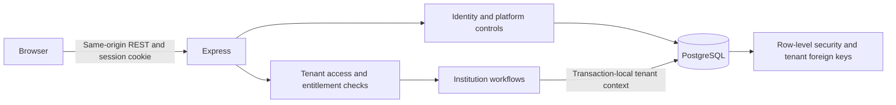

# Architecture

ELI EdTech is a TypeScript modular monolith. The React SPA and Express API can run behind one HTTPS origin. Prisma 7 uses the PostgreSQL driver adapter. SQL migrations manage PostgreSQL-specific constraints and row-level security.

## Request boundaries

1. The browser sends an opaque session cookie. Write requests carry the workspace origin and the ELI request header.
2. The API resolves the session’s selected institution and its active membership. The URL must name the same institution.
3. Module authorization checks the role and subscription. Additional record filters enforce class assignment, student ownership, guardian linkage and publication state.
4. The transaction establishes tenant context for PostgreSQL policies. Application queries include tenant predicates. Composite foreign keys constrain references to members and records in the same institution.
5. Writes and their audit events share a transaction. Record versions catch stale browser edits. Tenant-local advisory locks serialize workflows that check related records before writing.

Platform administration is a separate session scope. Its API reads institution and subscription metadata. Private records remain accessible only through the institution’s own membership and authorization path.

## Roles

| Role | Scope |
| --- | --- |
| Platform Super Administrator | Institution metadata, subscription management and renewal |
| Institution Administrator | Institution modules, profile, invitations, access suspension, audit and subscription |
| Principal | Institutional academic, financial and library oversight |
| Registrar | Admissions, rosters, academic catalogue, assessment publication and credentials |
| Accountant | Fee schedules, invoices, receipts and the student names needed to identify accounts |
| Teacher or Lecturer | Assigned classes and rosters, attendance, assessments, draft grades and learning resources |
| Student | Linked profile, enrolments, attendance, published learning and academic records, own invoices and submissions |
| Parent or Guardian | Records of the students linked to the guardian by the institution |
| Librarian | Library catalogue and checkout, with student lookup |

The catalogue used by the API and navigation lives in `shared/catalog.ts`. API checks decide access even when a URL or request is entered directly. Each membership has one role and users can sign in to multiple institutions with different roles.

## Commercial model

- **Basic** covers academic administration, portals, fees, attendance and in-app communications.
- **Professional** adds the LMS, library and credentials. New institutions start with a 14-day Professional trial.
- **Enterprise** adds white-label workspace naming. Workspace name, colour, time zone and currency are configurable.
- Platform administrators set monthly or annual billing periods, onboarding fees, renewal dates and suspension. Expiry is enforced during requests using the stored period end.
- School fee receipts and ELI subscription billing are distinct workflows. Subscription renewals are currently administered manually. The roadmap covers provider integration for MTN MoMo and Airtel Money.

Hosting, background maintenance and monitoring are described in [Deployment](DEPLOYMENT.md). REST clients, including a future Kotlin Multiplatform app, should use a versioned API and an explicitly designed native session flow.
